

# 🎀 Sofia's 3D Models

**Stylized low-poly Blender models made for my Roblox game**  
*Build Your Own Pet*

⋆｡ﾟ☁︎｡⋆｡ ﾟ☾ ﾟ｡⋆ &nbsp; =^･ω･^= &nbsp; ⋆｡ﾟ☁︎｡⋆｡ ﾟ☾ ﾟ｡⋆

## ✨ About

33 models exported from Blender to **glTF (.glb)** with Draco compression.  
GitHub can't preview `.glb` in 3D — open them in the **[3D showroom on my site](https://sofia-stetsiuk-portfolio.vercel.app/en#showroom)**, in Blender (*File → Import → glTF 2.0*), or drag into [gltf-viewer.donmccurdy.com](https://gltf-viewer.donmccurdy.com/).

> 💡 All models are also published **for free** on the Roblox Creator Store — each card has a 🛒 link.

## 🐉 Bubble Lagoon

<table>
<tr>
<td align="center" width="25%">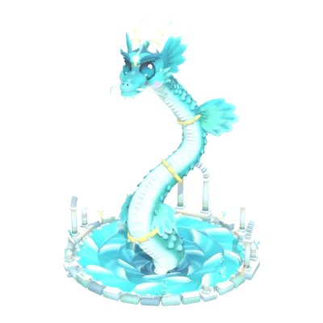 <b>Bubble Lagoon Sea Dragon</b> 118 129 tris · 482 KB <a href="build-your-pet/bubble-lagoon/bubble-lagoon-dragon.glb">⬇️ .glb</a> · <a href="https://create.roblox.com/store/asset/106866128680722">🛒 Roblox</a></td>
</tr>
</table>

## 🏰 Buildings

<table>
<tr>
<td align="center" width="25%">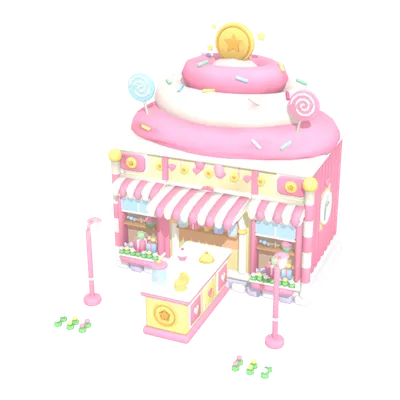 <b>Coin Shop</b> 29 952 tris · 141 KB <a href="build-your-pet/buildings/coin-shop.glb">⬇️ .glb</a> · <a href="https://create.roblox.com/store/asset/132105402001132">🛒 Roblox</a></td>
<td align="center" width="25%"> <b>Competition Stage</b> 28 080 tris · 120 KB <a href="build-your-pet/buildings/comp-stage.glb">⬇️ .glb</a> · <a href="https://create.roblox.com/store/asset/132105402001132">🛒 Roblox</a></td>
<td align="center" width="25%">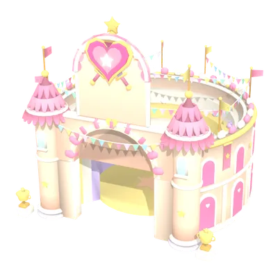 <b>PvP Arena</b> 29 625 tris · 158 KB <a href="build-your-pet/buildings/pvp-arena.glb">⬇️ .glb</a> · <a href="https://create.roblox.com/store/asset/132105402001132">🛒 Roblox</a></td>
<td align="center" width="25%"> <b>Spawn Gazebo</b> 19 884 tris · 88 KB <a href="build-your-pet/buildings/spawn-gazebo.glb">⬇️ .glb</a> · <a href="https://create.roblox.com/store/asset/132105402001132">🛒 Roblox</a></td>
</tr>
<tr>
<td align="center" width="25%">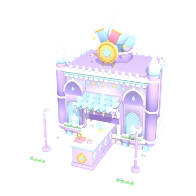 <b>Token Shop</b> 29 820 tris · 152 KB <a href="build-your-pet/buildings/token-shop.glb">⬇️ .glb</a> · <a href="https://create.roblox.com/store/asset/132105402001132">🛒 Roblox</a></td>
<td align="center" width="25%">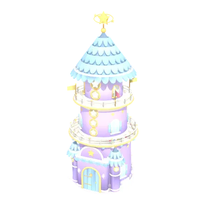 <b>Tower</b> 29 969 tris · 174 KB <a href="build-your-pet/buildings/tower.glb">⬇️ .glb</a> · <a href="https://create.roblox.com/store/asset/132105402001132">🛒 Roblox</a></td>
<td align="center" width="25%">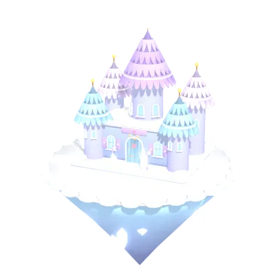 <b>Aurora Switch Palace</b> 32 336 tris · 168 KB <a href="build-your-pet/buildings/aurora-switch-palace.glb">⬇️ .glb</a> · <a href="https://create.roblox.com/store/asset/99035061910645">🛒 Roblox</a></td>
<td align="center" width="25%">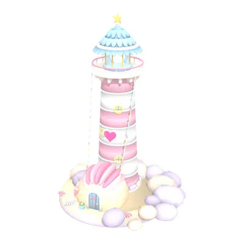 <b>Bubble Lagoon Lighthouse</b> 23 440 tris · 107 KB <a href="build-your-pet/buildings/bubble-lagoon-lighthouse.glb">⬇️ .glb</a> · <a href="https://create.roblox.com/store/asset/99035061910645">🛒 Roblox</a></td>
</tr>
<tr>
<td align="center" width="25%">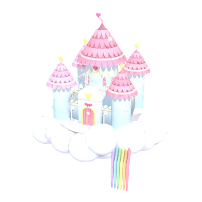 <b>Cloud Gardens Castle</b> 35 576 tris · 195 KB <a href="build-your-pet/buildings/cloud-gardens-castle.glb">⬇️ .glb</a> · <a href="https://create.roblox.com/store/asset/99035061910645">🛒 Roblox</a></td>
<td align="center" width="25%">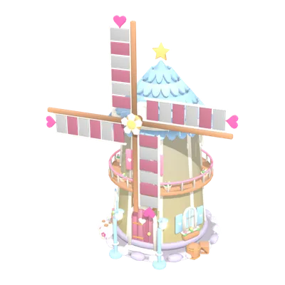 <b>Hidden Meadow Windmill</b> 29 504 tris · 133 KB <a href="build-your-pet/buildings/hidden-meadow-windmill.glb">⬇️ .glb</a> · <a href="https://create.roblox.com/store/asset/99035061910645">🛒 Roblox</a></td>
<td align="center" width="25%">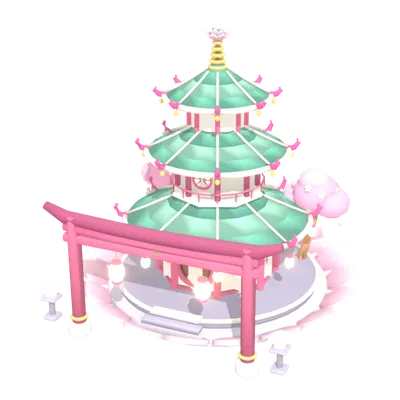 <b>Leaf Leap Pagoda</b> 18 728 tris · 98 KB <a href="build-your-pet/buildings/leaf-leap-pagoda.glb">⬇️ .glb</a> · <a href="https://create.roblox.com/store/asset/99035061910645">🛒 Roblox</a></td>
<td align="center" width="25%"> <b>Mushroom Maze House</b> 35 550 tris · 151 KB <a href="build-your-pet/buildings/mushroom-maze-house.glb">⬇️ .glb</a> · <a href="https://create.roblox.com/store/asset/99035061910645">🛒 Roblox</a></td>
</tr>
<tr>
<td align="center" width="25%">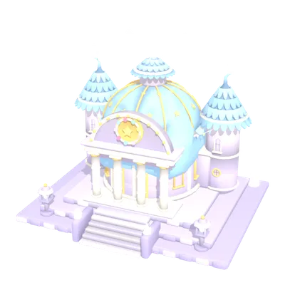 <b>Pebble Peaks Temple</b> 35 152 tris · 179 KB <a href="build-your-pet/buildings/pebble-peaks-temple.glb">⬇️ .glb</a> · <a href="https://create.roblox.com/store/asset/99035061910645">🛒 Roblox</a></td>
<td align="center" width="25%">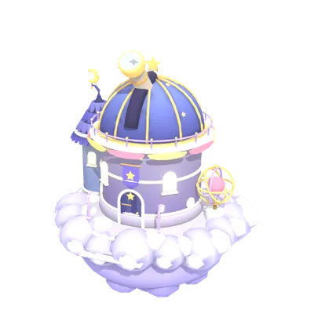 <b>Starfall Scoop Observatory</b> 29 828 tris · 132 KB <a href="build-your-pet/buildings/starfall-scoop-observatory.glb">⬇️ .glb</a> · <a href="https://create.roblox.com/store/asset/99035061910645">🛒 Roblox</a></td>
<td align="center" width="25%">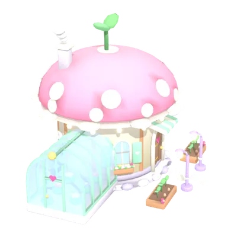 <b>Whisperwood Cottage</b> 27 180 tris · 111 KB <a href="build-your-pet/buildings/whisperwood-cottage.glb">⬇️ .glb</a> · <a href="https://create.roblox.com/store/asset/99035061910645">🛒 Roblox</a></td>
<td align="center" width="25%">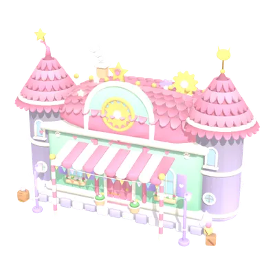 <b>Workshop</b> 44 672 tris · 226 KB <a href="build-your-pet/buildings/workshop.glb">⬇️ .glb</a> · <a href="https://create.roblox.com/store/asset/132105402001132">🛒 Roblox</a></td>
</tr>
</table>

## 🌳 Trees

<table>
<tr>
<td align="center" width="25%">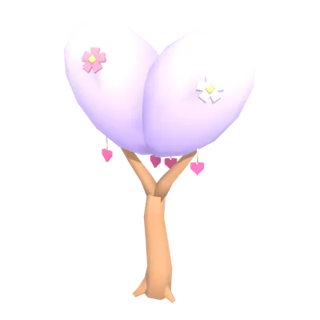 <b>Lilac Tree</b> 1 198 tris · 9 KB <a href="build-your-pet/trees/tree-lilac.glb">⬇️ .glb</a> · <a href="https://create.roblox.com/store/asset/128077058614717">🛒 Roblox</a></td>
<td align="center" width="25%">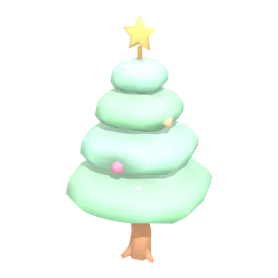 <b>Mint Tree</b> 1 164 tris · 7 KB <a href="build-your-pet/trees/tree-mint.glb">⬇️ .glb</a> · <a href="https://create.roblox.com/store/asset/128077058614717">🛒 Roblox</a></td>
<td align="center" width="25%">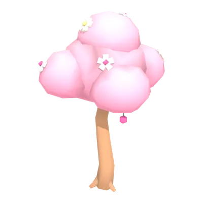 <b>Pink Tree</b> 1 290 tris · 9 KB <a href="build-your-pet/trees/tree-pink.glb">⬇️ .glb</a> · <a href="https://create.roblox.com/store/asset/128077058614717">🛒 Roblox</a></td>
<td align="center" width="25%">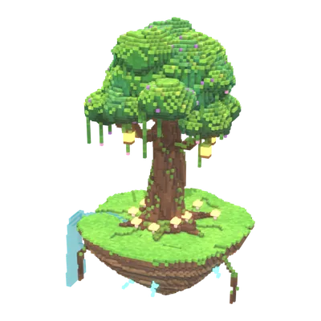 <b>Ancient Tree on an Island</b> 62 142 tris · 375 KB <a href="build-your-pet/trees/tree-ancient-island.glb">⬇️ .glb</a> · <a href="https://create.roblox.com/store/asset/96989146849250">🛒 Roblox</a></td>
</tr>
<tr>
<td align="center" width="25%">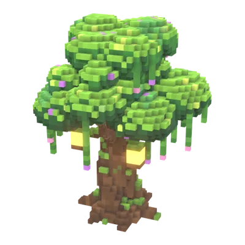 <b>Ancient Tree, large</b> 13 886 tris · 86 KB <a href="build-your-pet/trees/tree-ancient-l.glb">⬇️ .glb</a> · <a href="https://create.roblox.com/store/asset/118286549704362">🛒 Roblox</a></td>
<td align="center" width="25%">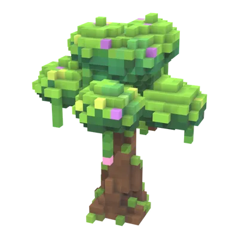 <b>Ancient Tree, medium</b> 4 396 tris · 28 KB <a href="build-your-pet/trees/tree-ancient-m.glb">⬇️ .glb</a> · <a href="https://create.roblox.com/store/asset/118286549704362">🛒 Roblox</a></td>
<td align="center" width="25%">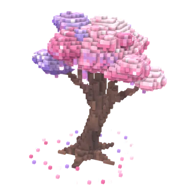 <b>Blossom Tree, large</b> 13 776 tris · 90 KB <a href="build-your-pet/trees/tree-blossom-l.glb">⬇️ .glb</a> · <a href="https://create.roblox.com/store/asset/118286549704362">🛒 Roblox</a></td>
<td align="center" width="25%">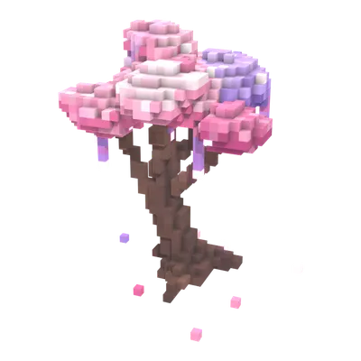 <b>Blossom Tree, medium</b> 4 484 tris · 31 KB <a href="build-your-pet/trees/tree-blossom-m.glb">⬇️ .glb</a> · <a href="https://create.roblox.com/store/asset/118286549704362">🛒 Roblox</a></td>
</tr>
<tr>
<td align="center" width="25%">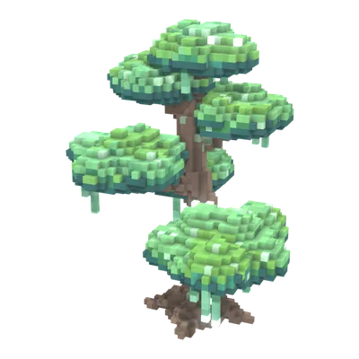 <b>Cloud Tree, large</b> 13 672 tris · 87 KB <a href="build-your-pet/trees/tree-cloud-l.glb">⬇️ .glb</a> · <a href="https://create.roblox.com/store/asset/118286549704362">🛒 Roblox</a></td>
<td align="center" width="25%">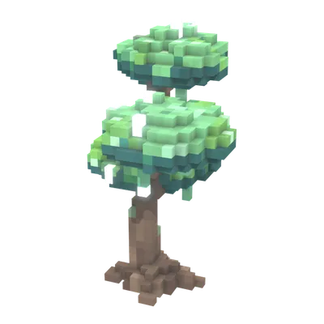 <b>Cloud Tree, medium</b> 4 430 tris · 29 KB <a href="build-your-pet/trees/tree-cloud-m.glb">⬇️ .glb</a> · <a href="https://create.roblox.com/store/asset/118286549704362">🛒 Roblox</a></td>
<td align="center" width="25%">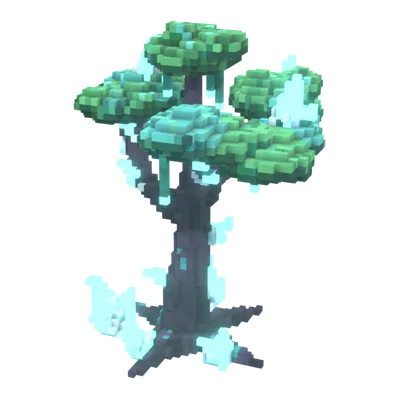 <b>Crystal Tree, large</b> 13 158 tris · 70 KB <a href="build-your-pet/trees/tree-crystal-l.glb">⬇️ .glb</a> · <a href="https://create.roblox.com/store/asset/118286549704362">🛒 Roblox</a></td>
<td align="center" width="25%">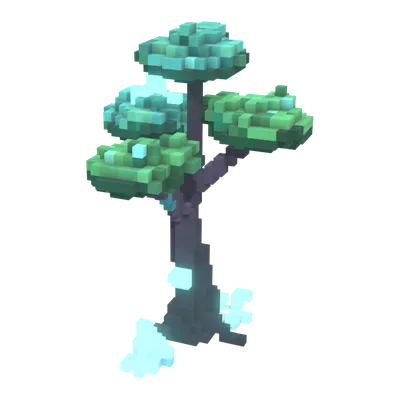 <b>Crystal Tree, medium</b> 4 398 tris · 26 KB <a href="build-your-pet/trees/tree-crystal-m.glb">⬇️ .glb</a> · <a href="https://create.roblox.com/store/asset/118286549704362">🛒 Roblox</a></td>
</tr>
<tr>
<td align="center" width="25%">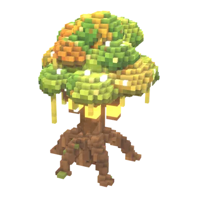 <b>Fairy Tree, large</b> 13 548 tris · 85 KB <a href="build-your-pet/trees/tree-fairy-l.glb">⬇️ .glb</a> · <a href="https://create.roblox.com/store/asset/118286549704362">🛒 Roblox</a></td>
<td align="center" width="25%">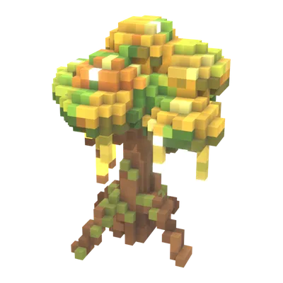 <b>Fairy Tree, medium</b> 4 448 tris · 32 KB <a href="build-your-pet/trees/tree-fairy-m.glb">⬇️ .glb</a> · <a href="https://create.roblox.com/store/asset/118286549704362">🛒 Roblox</a></td>
<td align="center" width="25%">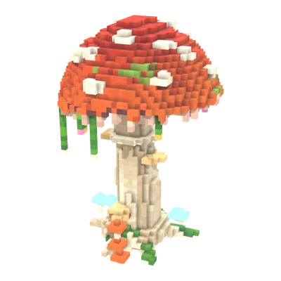 <b>Mushroom Tree, large</b> 13 126 tris · 90 KB <a href="build-your-pet/trees/tree-mushroom-l.glb">⬇️ .glb</a> · <a href="https://create.roblox.com/store/asset/118286549704362">🛒 Roblox</a></td>
<td align="center" width="25%">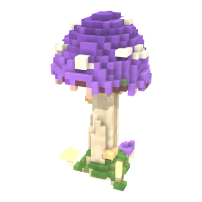 <b>Mushroom Tree, medium</b> 4 356 tris · 31 KB <a href="build-your-pet/trees/tree-mushroom-m.glb">⬇️ .glb</a> · <a href="https://create.roblox.com/store/asset/118286549704362">🛒 Roblox</a></td>
</tr>
</table>

⋆｡ﾟ☁︎｡⋆｡ ﾟ☾ ﾟ｡⋆ &nbsp; =^･ω･^= &nbsp; ⋆｡ﾟ☁︎｡⋆｡ ﾟ☾ ﾟ｡⋆

## 📜 License

© Sofia Stetsiuk ([@silestiari](https://github.com/silestiari)). Free to use in Roblox via the Creator Store. Want to use them somewhere else? [Message me](https://t.me/silestiari) 💌

🎮 Made by **[Sofia Stetsiuk](https://github.com/silestiari)** — QA Engineer × Game Designer · [Portfolio](https://sofia-stetsiuk-portfolio.vercel.app/en) · [Telegram](https://t.me/silestiari)

